# Ocean Harness: bench test before it goes in the car

Tools: a multimeter (ohms, continuity, diode, DC volts, DC mA) and a current-limited DC bench supply.
Nothing here needs the car, the comma device or a USB cable.

Expected values come from the schematic as of 2026-11-16 (K1 = G5V-2-H1 DC12, 960 Ω coil; R5 = 160 Ω;
R6 = 3.3 kΩ; Q1 = DMP4015SSSQ-13).

**Stop at the first failure.** Every step exists to catch something that could hurt the car or the box.

Each step has a picture rendered from the KiCad 3D model, with markers placed from the actual pad coordinates.

## Finding pins

This board has **no test points** — every measurement below lands on a connector solder joint or a
component pad. Use fine probe tips and take care not to bridge neighbouring pads.

- **Solder side pictures** (steps 1.3–1.6, 2.1, 2.2, 2.4–2.6b) show the board flipped **left-to-right**,
  the way it lands when you turn it over to probe. That puts **J3 and J5 on the left, J4 and J6 on the
  right** — the opposite of the top view. Every picture says so in its subtitle.
- **J3 / J4 (Molex 20-way) and J5 / J6 (Molex 16-way):** probe their solder joints from the back.
  Pins 1–10 and 11–20 are in two columns; the pictures number every pin.
- **Power input:** there is no separate power connector. Feed the board at **J3 pin 1 (+12 V)** and
  **J3 pin 14 (GND)**, which is exactly where the car feeds it.
- **Board GND:** J3.14, J4.14, or the GND pad of any of C1 / C2 / C3.
- **Measurement points** (top side, probe the cap's non-GND pad — the **left-hand** pad of each):

| Rail | Probe at | What it is |
|---|---|---|
| VBAT_FUSED | F1, right-hand pad | after the 3 A fuse, before Q1 |
| 12V_PROT | C1, left-hand pad | after Q1, feeds the comma device |
| VIN | C2, left-hand pad | relay coil rail, 12V_PROT through R5 |
| SW_VCC | C3, left-hand pad | DG419 supply, VIN through D12 + R6 |
| ADAS_CAN_H_C / _L_C | K1 pin 9 / pin 8 | comma side of the intercept, solder side |
| SBU 1 | R2, upper pad | the comma device's switch control line |

> **One thing to know before you start.** J3.1 goes straight to J4.1 on unfused copper, so the moment you
> put 12 V on J3.1 the ECU connector is live too. That is the design — the ECU keeps its supply whatever
> the box is doing — but it means a slip on J4.1 goes straight back to your bench supply with F1 nowhere
> in the path. Keep the current limit low until step 2.2 passes.

---

## Part 1: unpowered checks

### 1.1 Visual

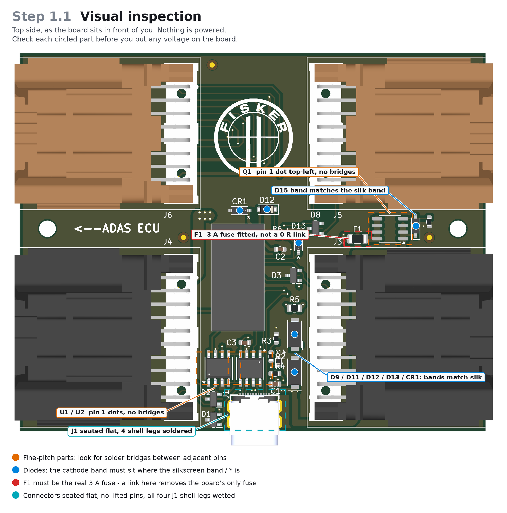

- [ ] **Wash the board first** if it has come straight from the assembler. Do this before you inspect,
      and certainly before you measure anything.
- [ ] No solder bridges on Q1 (SOIC-8) or U1 / U2 (the two DG419s).
- [ ] Q1's pin-1 dot is at the top-left, matching the silk.
- [ ] Every diode band sits where the silk band / `*` is: D9, D11, D12, D13, D15, CR1.
- [ ] **F1 is the real 3 A fuse**, not a 0 Ω link. It is the board's only fuse.
- [ ] J1 (USB-C) is seated flat with all four shell legs wetted; J3–J6 are flat with no lifted pins.

**Why washing comes first.** Assembly houses use no-clean flux and leave the residue on. It is harmless to
the board, but it is mildly conductive — typically 10 kΩ to 1 MΩ between neighbouring pads — and that is
low enough to put real-looking voltages on pins that should be floating. The ADAS CAN pins sit two pads
from SW_VCC on U1 and U2, so a residue path there shows up as roughly 9 V on J3/J4 pin 19 or 20 in step
2.4, which looks exactly like the board back-feeding a car line. Residue also hides hairline bridges and
makes probe contact unreliable, which is enough on its own to send the resistance readings in step 1.2
wandering.

Isopropyl alcohol and a stiff brush, worked into the fine-pitch parts and the connector solder joints, then
dry it fully before powering anything. If you would rather not wash it, that is a defensible choice — but
expect the leakage, and read step 2.4's loaded-measurement note before you panic at a reading.

### 1.2 No shorts on the power rails

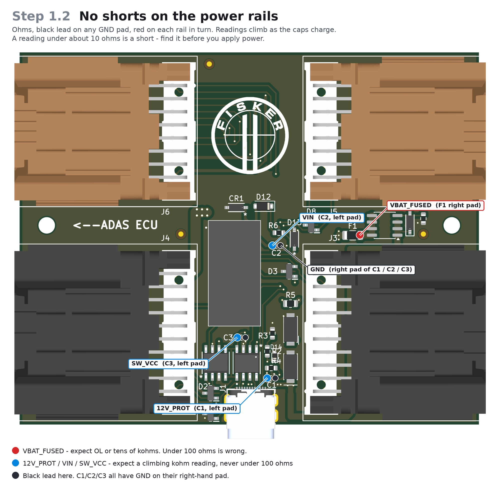

Black lead on a GND pad, red on each rail in turn. The caps make readings climb — take the value after a
second or two.

| From → GND | Expected | Fail if |
|---|---|---|
| VBAT_FUSED (F1 right pad) | high; a few kΩ to OL depending on your meter's test voltage | < 100 Ω |
| 12V_PROT (C1 left pad) | **≈ 1.1 kΩ** — that's R5 + the relay coil | < 100 Ω |
| VIN (C2 left pad) | **≈ 960 Ω** — the relay coil on its own | < 100 Ω |
| SW_VCC (C3 left pad) | high, climbing (MΩ) | < 100 Ω |

The 1.1 kΩ and 960 Ω readings are a bonus: they confirm R5 and K1's coil are both present and the right
value. A reading under ~10 Ω anywhere is a short — find it before you apply power.

### 1.3 Passthrough continuity — CON1 section A

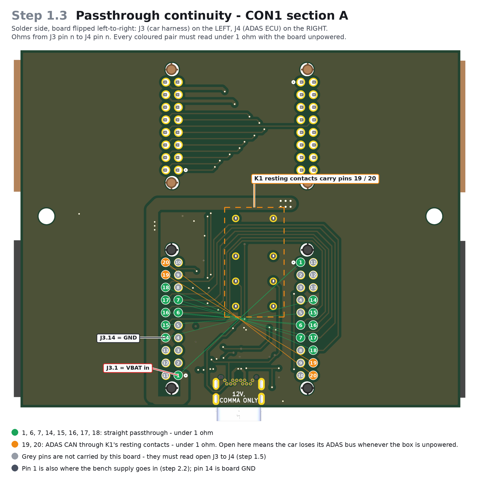

Ohms from J3 pin *n* to J4 pin *n*. Each must read **< 1 Ω**:

| Pins | Notes |
|---|---|
| 1 | VBAT to the ECU, unfused by design |
| 6, 7, 15, 16, 17, 18 | the six ultrasonic sensor lines |
| 14 | GND |
| 19, 20 | ADAS CAN, through **K1's resting contacts** |

If 19 or 20 is open with the box unpowered, **the car loses its ADAS bus whenever the box is off.** That is
the single most important reading in this document. Don't install the box until it's fixed.

Pins 2, 3, 4, 5, 8, 9, 10, 11, 12 and 13 are not carried — they're checked in 1.5.

### 1.4 Passthrough continuity — CON1 section B

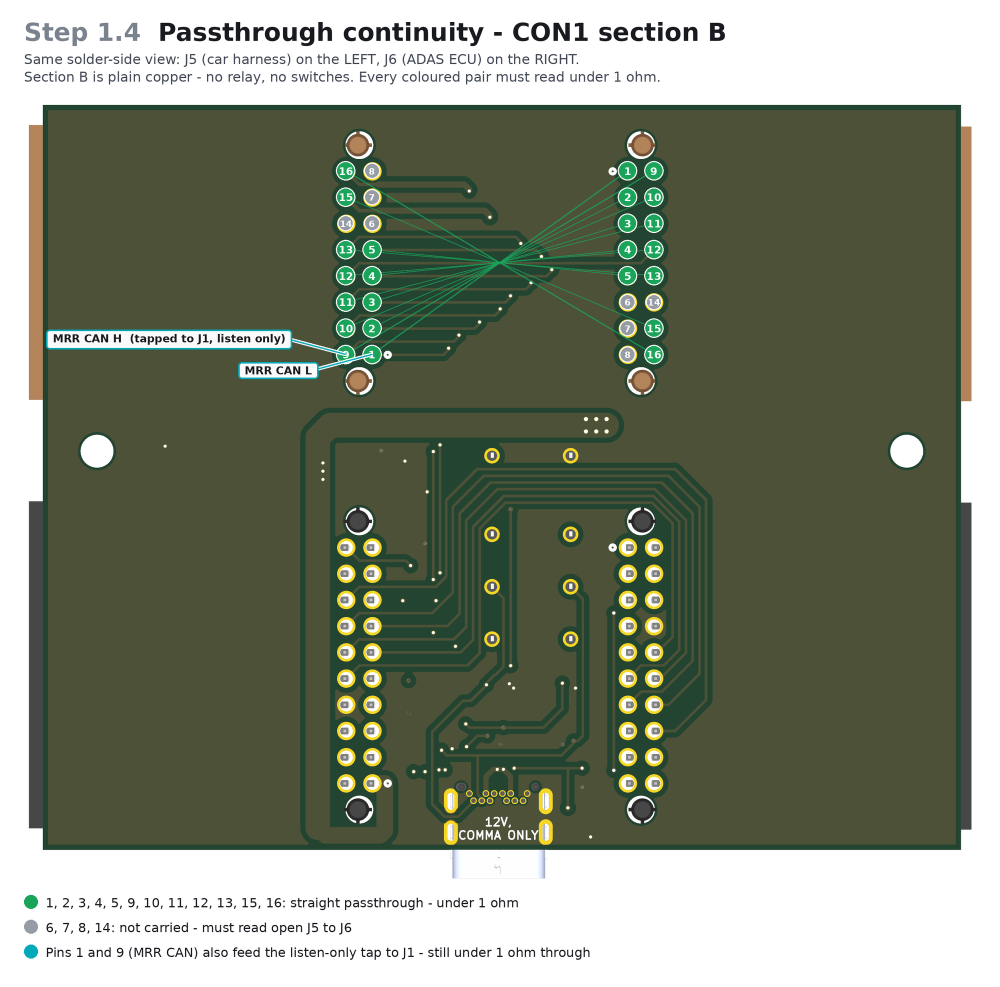

Section B is plain copper: no relay, no switches. J5 pin *n* to J6 pin *n*, each **< 1 Ω**:

| Pins | Signal |
|---|---|
| 1, 9 | mid-range radar CAN L / H (also tapped to J1, listen-only) |
| 2, 3 | corner radar FR CAN H / L |
| 4, 5 | corner radar RR CAN H / L |
| 10, 11 | corner radar FL CAN H / L |
| 12, 13 | corner radar RL CAN H / L |
| 15, 16 | DMS LED drive L / H |

Pins 6, 7, 8 and 14 are not carried and must read open J5 ↔ J6.

### 1.5 Isolation: nothing from the car may touch the box's own power

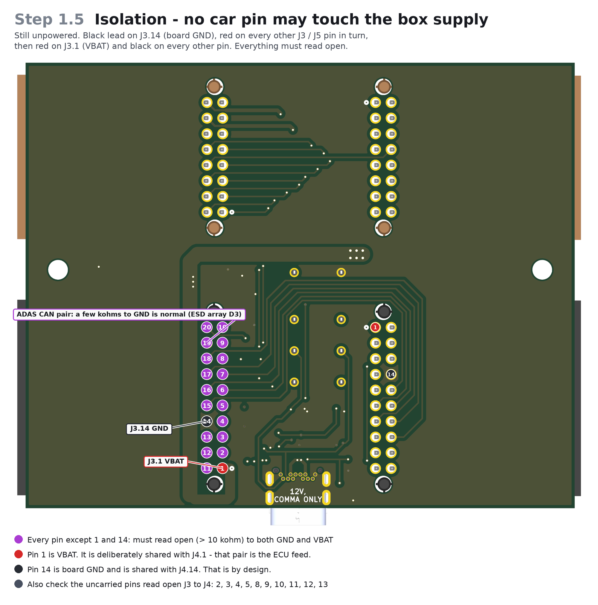

Black lead on **J3.14 (GND)**, red on every other J3 and J5 pin in turn. Then red on **J3.1 (VBAT)** and
black on every other pin. Everything should read **OL / > 10 kΩ**.

| Pin | Must not touch | Why |
|---|---|---|
| J3.1 (VBAT) | any CAN or sensor pin | 12 V on a bus line damages whatever is on the other end |
| every signal pin | GND | a grounded bus line kills that bus |
| J3.19 / 20 (ADAS CAN) | — | a few kΩ to GND is normal here: that's D3's ESD array, not a fault |

Also confirm the uncarried pins read open J3 ↔ J4: **2, 3, 4, 5, 8, 9, 10, 11, 12, 13**.

### 1.6 No terminator across the car's CAN pair

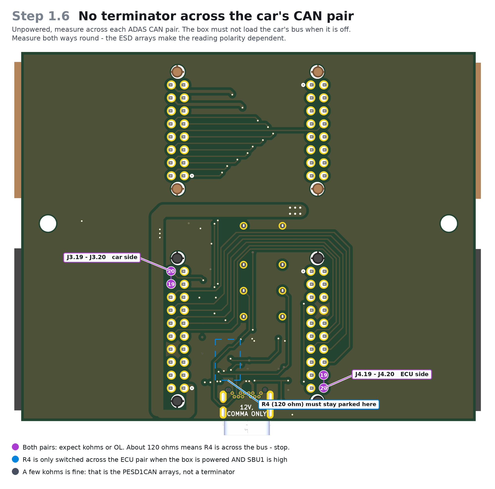

R4 (120 Ω) is only meant to appear across the ECU-side pair when the box is powered **and** SBU 1 is high.
While the box is off it must stay parked.

| Pair | Expected (unpowered) | Fail if |
|---|---|---|
| J3.19 ↔ J3.20 (car side) | kΩ or OL | **≈ 120 Ω** |
| J4.19 ↔ J4.20 (ECU side) | kΩ or OL | **≈ 120 Ω** |

Measure each pair both ways round — the ESD arrays make the reading polarity-dependent. A few kΩ is fine;
that's the PESD1CANs, not a terminator.

---

## Part 2: powered from the bench supply

Supply set to **12.0 V, current limit 100 mA**, output off. Red to **J3.1**, black to **J3.14**.

### 2.1 Reverse polarity — do this first

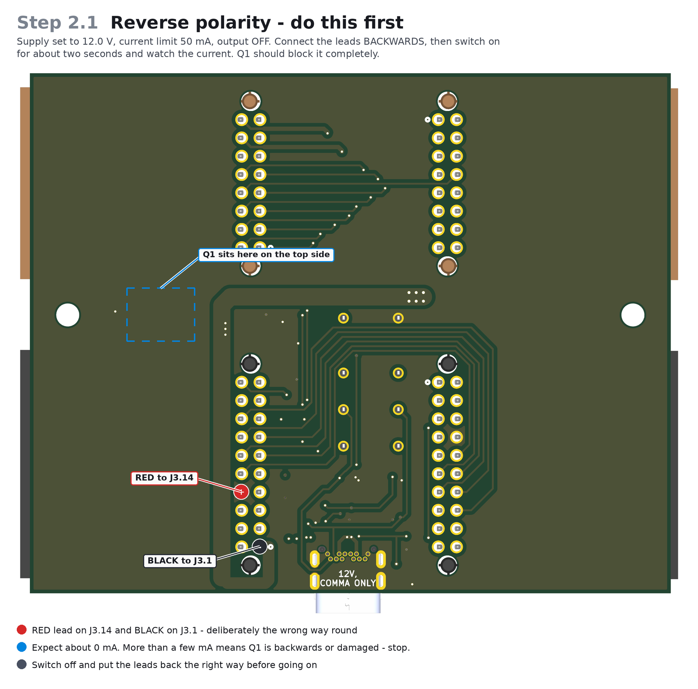

Drop the limit to **50 mA** and connect the leads **backwards** (red to J3.14, black to J3.1).

- [ ] Switch on for about two seconds and watch the current.
- [ ] **Expect ≈ 0 mA.** Q1 is a P-FET wired drain-to-input: with the supply reversed its channel is off and
      its body diode is reverse-biased, so nothing conducts and F1 survives.
- [ ] More than a few mA means Q1 is fitted backwards or damaged. Stop.
- [ ] Switch off and put the leads back the right way.

### 2.2 First power-up

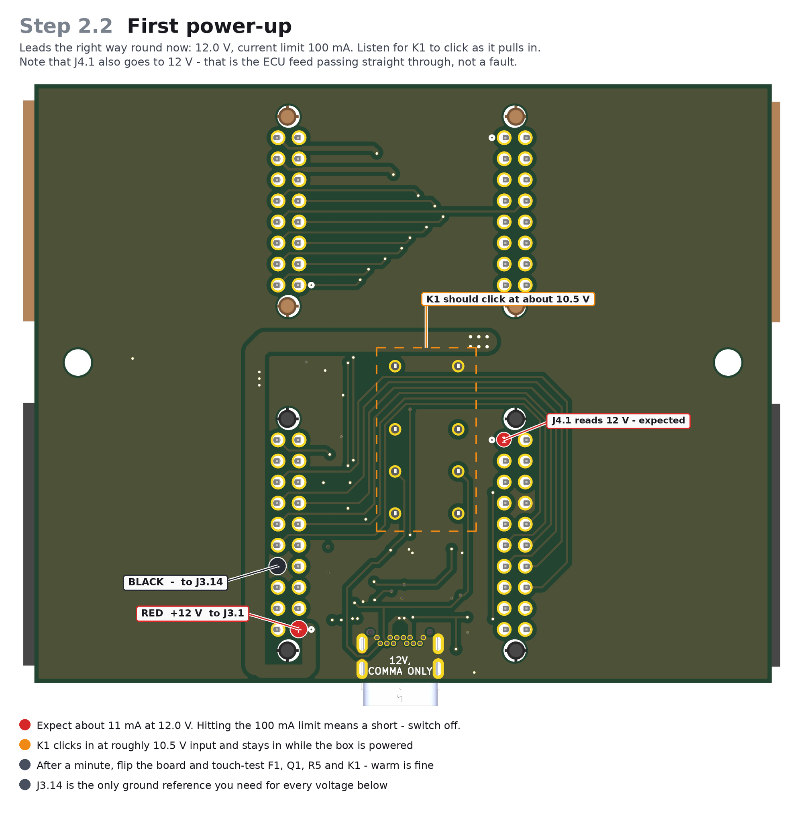

- [ ] Turn on at 12.0 V / 100 mA.
- [ ] **K1 should click.** It pulls in at roughly **10.5 V** input and stays in while the box has power.
- [ ] **Current: expect about 11 mA** at 12.0 V — that is almost entirely K1's coil (10.7 mA). About 12.5 mA
      at 14 V. If the supply hits its limit and the voltage sags, switch off and look for a short.
- [ ] J4.1 now reads 12 V. **That is expected** — it's the ECU feed passing straight through.
- [ ] After a minute, flip the board and touch-test F1, Q1, R5 and K1. Warm is fine; too hot to hold is not.

### 2.3 Rail voltages

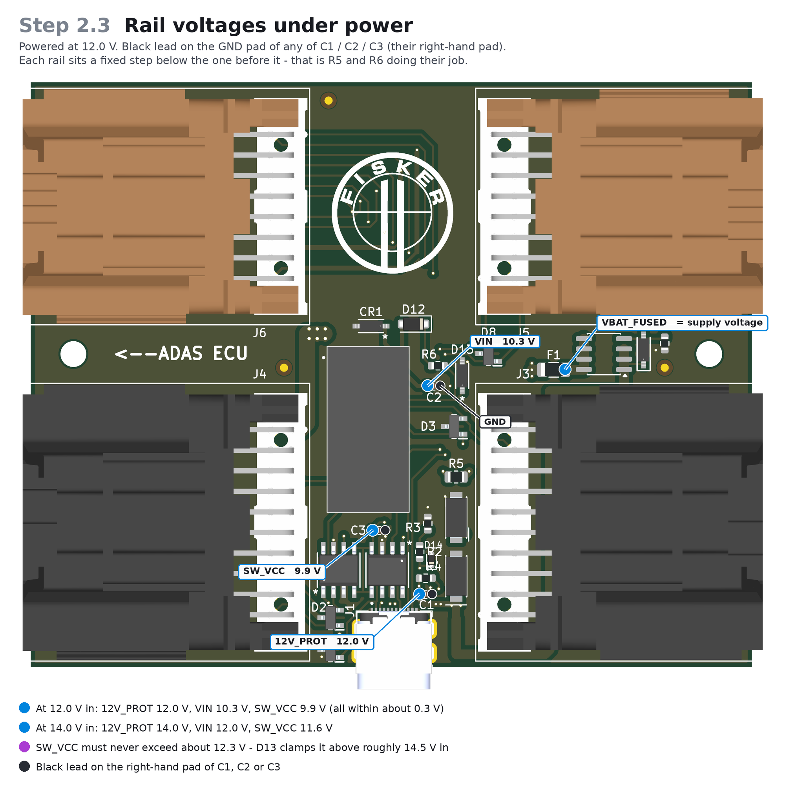

Black lead on the GND pad of C1 / C2 / C3 (their right-hand pad).

| Rail | at 12.0 V in | at 14.0 V in | Notes |
|---|---|---|---|
| VBAT_FUSED | 12.0 V | 14.0 V | F1 drops nothing measurable |
| 12V_PROT | 12.0 V | 14.0 V | Q1 drops ~0.1 mV at this current |
| VIN | **10.3 V** | **12.0 V** | 12V_PROT × 960/1120, set by R5 and the coil |
| SW_VCC | **9.9 V** | **11.6 V** | VIN less D12's ~0.35 V |

All within about 0.3 V. The point of the VIN figure is that the coil sits at its 12 V rating when the car
is running at 14 V — that's R5 doing its job.

### 2.3b Input range sweep

Raise the limit to 200 mA and sweep the supply slowly from **9 V to 16 V**.

- [ ] K1 is pulled in by about 10.5 V on the way up. Coming back down it holds in far below that — relays
      have a lot of hysteresis, and this one won't release until the coil is near 1 V — so don't expect it to
      drop out at the same voltage. No chattering either way.
- [ ] **SW_VCC never exceeds about 12.3 V.** D13 (BZT52C12) starts clamping at roughly 14.5 V input; below
      that SW_VCC just tracks VIN.
- [ ] Current rises smoothly with voltage; nothing steps or runs away.

Don't go above ~16 V: D9 and D11 (SMAJ16A) start conducting around 17.8 V and F1 is the next thing in line.

### 2.4 Nothing from the box drives a car pin

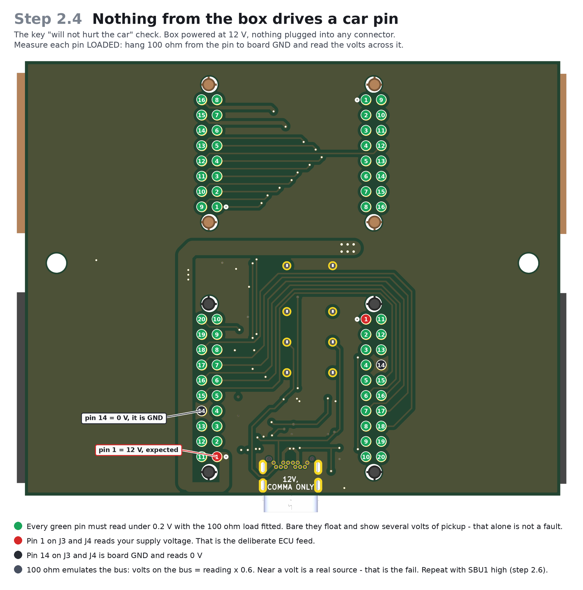

This is the key "won't hurt the car" check. Box powered at 12 V, **nothing plugged into any connector**.

**Measure these pins loaded, and load them with 100 Ω.** On the bench they are floating — no bus, no
termination, nothing driving them — so a bare reading tells you almost nothing. A floating trace read with a
10 MΩ meter will sit at several volts from capacitive pickup and from the analog switches' own internal
biasing, and that is normal, not a fault.

100 Ω is the right load because it is close to the 60 Ω the real bus presents. That makes the number mean
something directly:

> volts the pin would put on the bus ≈ loaded reading × 0.6

| Pins | Expected, with 100 Ω to GND |
|---|---|
| J3.1 and J4.1 | your supply voltage — the deliberate ECU feed |
| J3.14 and J4.14 | 0 V, they are GND |
| every other pin on all four connectors | **under 0.2 V** |

0.2 V across 100 Ω is 2 mA, which would shift the bus by roughly 120 mV against a 900 mV receiver
threshold — comfortable margin.

**Fail:** anything approaching a volt. That is a real source with current behind it, and it is the box
pushing voltage onto a car line.

A reading between the two is a high-impedance leak rather than a driver. Work out what is behind it:

> source impedance ≈ 100 Ω × (unloaded volts − loaded volts) ÷ loaded volts

Tens of kΩ is leakage and harmless at these currents. Under a few kΩ is worth tracing.

Use a resistor rated 1 W or better, or take the reading briskly — if a pin really is sitting at 12 V, a
100 Ω load dissipates 1.4 W.

Repeat the sweep with SBU 1 high (step 2.6) before you call this one done.

### 2.5 Relay switchover and release

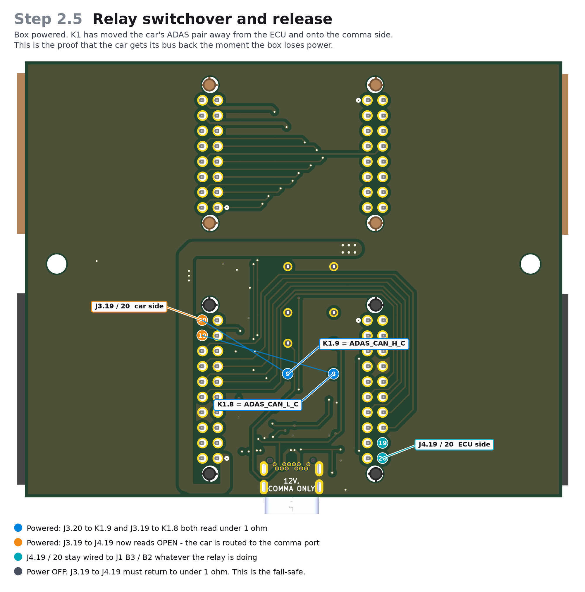

With the box powered, K1 has handed the car's ADAS pair to the comma side:

| Measurement | Powered | Unpowered |
|---|---|---|
| J3.20 ↔ K1 pin 9 | **< 1 Ω** | open |
| J3.19 ↔ K1 pin 8 | **< 1 Ω** | open |
| J3.20 ↔ J4.20 | **open** | **< 1 Ω** |
| J3.19 ↔ J4.19 | **open** | **< 1 Ω** |

- [ ] Power off and confirm the right-hand column. **J3.19 ↔ J4.19 returning to < 1 Ω is your proof that the
      car is restored the instant the box loses power.**

J4.19 / 20 stay wired to J1 B3 / B2 the whole time — the ECU is permanently on the comma device's `_MOD`
port whatever the relay is doing.

Ohm readings on relay contacts are fine with the box powered, because nothing is driving those lines on the
bench.

### 2.6 SBU 1 and the analog switches

SBU 1 is how the comma device decides whether the car and ECU stay joined. Low (or floating) is the safe
default: R2 + R3 pull it to GND through 240 Ω.

#### 2.6a Where to drive it

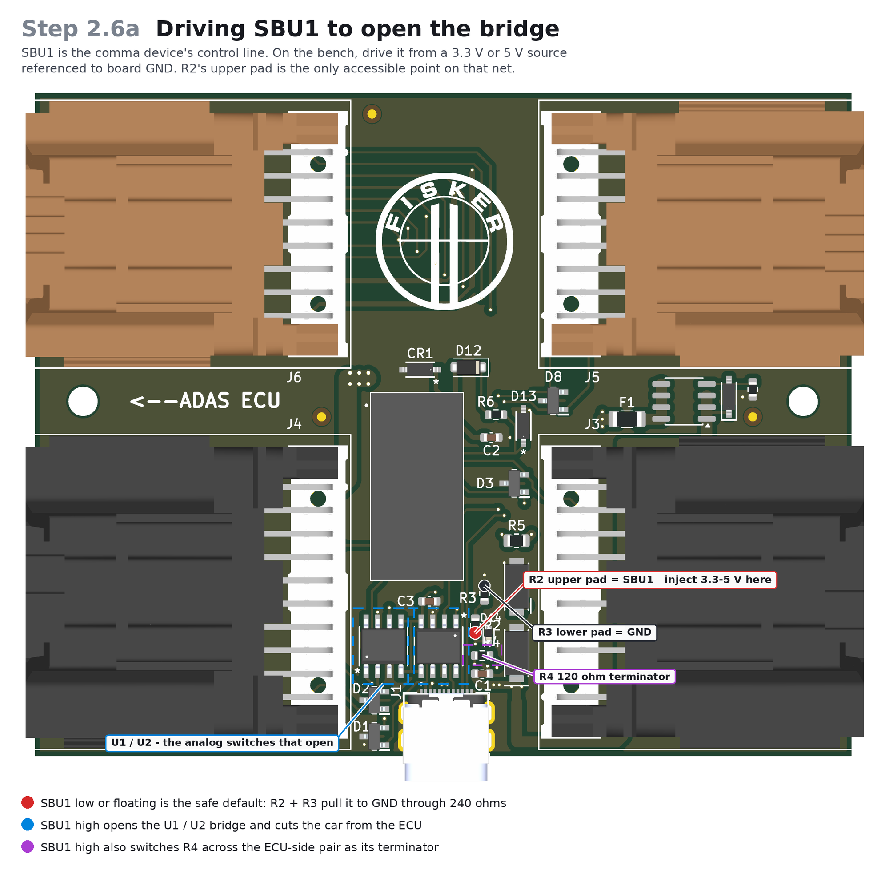

Feed **3.3 V or 5 V** from a source referenced to board GND into **R2's upper pad**. That draws about
14 mA through R2 + R3, which is fine. The DG419's logic input is happy with 3.3 V against its 12 V supply.

#### 2.6b What should change

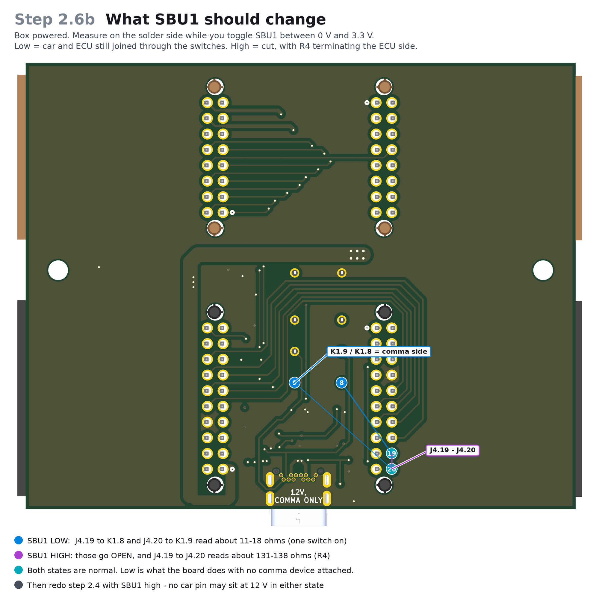

| Measurement | SBU 1 low | SBU 1 high |
|---|---|---|
| J4.19 ↔ K1 pin 8 | **11–18 Ω** (one DG419 on) | **open** |
| J4.20 ↔ K1 pin 9 | **11–18 Ω** | **open** |
| J4.19 ↔ J4.20 | open | **131–138 Ω** (R4 + one RDS(on)) |

- [ ] Both states behave as above, and go back when you remove the 3.3 V.
- [ ] Redo step 2.4 with SBU 1 held high — no car pin may sit at 12 V in either state.

The 11–18 Ω is the DG419's on-resistance over temperature, and it is in the car↔ECU path whenever the box
is powered with SBU 1 low. It is worth knowing it's there; it is not a fault.

---

## Pass criteria before it goes in the car

- [ ] 1.1: board washed, no bridges, diode bands right, F1 is a real fuse.
- [ ] 1.2: no rail shorts; 12V_PROT ≈ 1.1 kΩ and VIN ≈ 960 Ω to GND.
- [ ] 1.3: every section A passthrough < 1 Ω with the box off, **including 19 and 20**.
- [ ] 1.4: every section B passthrough < 1 Ω; 6, 7, 8, 14 open.
- [ ] 1.5: no car pin connected to board GND or to VBAT.
- [ ] 1.6: no 120 Ω across either ADAS CAN pair while unpowered.
- [ ] 2.1: reverse polarity draws ≈ 0 mA.
- [ ] 2.2: K1 clicks, about 11 mA at 12 V, nothing hot.
- [ ] 2.3: VIN 10.3 V and SW_VCC 9.9 V at 12 V in; SW_VCC never above ~12.3 V.
- [ ] 2.4: no signal pin above 0.2 V **under a 100 Ω load to GND**, in both SBU 1 states.
- [ ] 2.5: relay releases to passthrough when power is removed.

**First time in the car:** plug the harness in with the comma device **unplugged** from J1, so the box is
unpowered and the relay is at rest, and confirm the car behaves exactly as stock. Only then plug in the
comma device.

---

## Regenerating the pictures

The figures are built from the KiCad 3D model, not drawn by hand. The generator renders the board top and
bottom with `kicad-cli pcb render --background transparent --quality basic -w 2800 -h 2380` (no `--floor`,
so there are no shadows), then places every marker from the pad coordinates in `Ocean Harness.kicad_pcb`.
The mm → pixel mapping was calibrated by diffing a render of the board against a render of the same board
carrying 1.6 mm silkscreen disks at four known coordinates; it is accurate to about 0.05 mm.

If the layout changes, the markers must be recalibrated — the mapping is tied to that exact render command
and image size.

[`BENCH_TEST.pdf`](BENCH_TEST.pdf) is this file rendered to A4 through headless Chrome. See
[`tools/bench_test/README.md`](tools/bench_test/README.md) for both commands.
