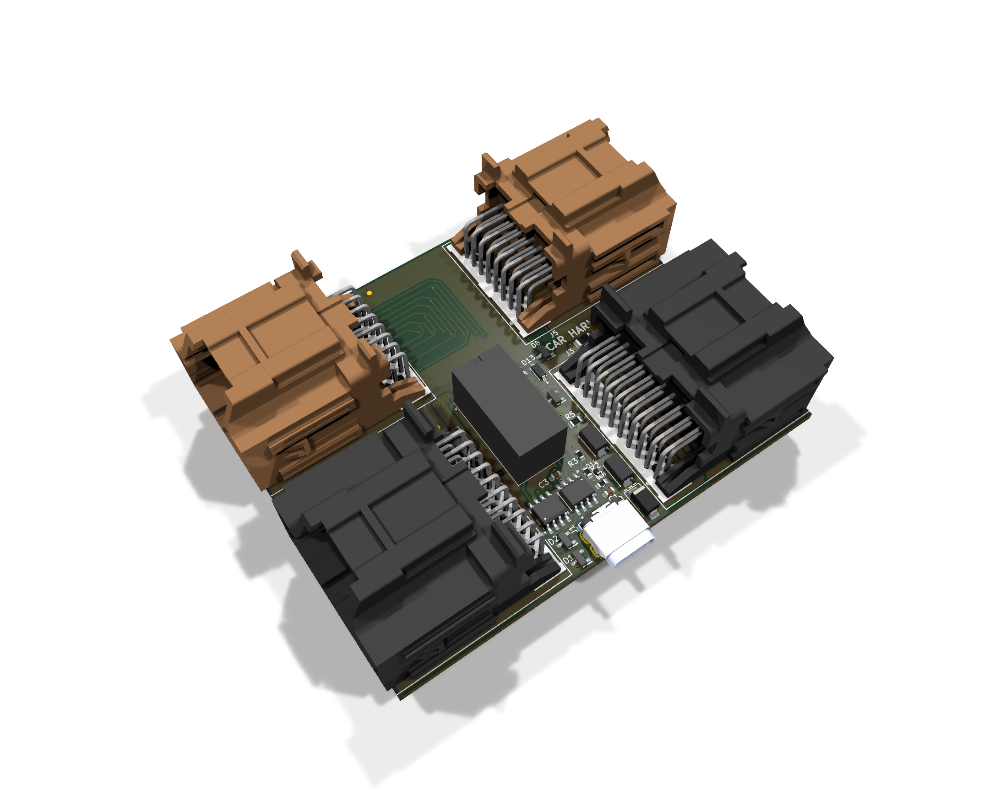

# Ocean Harness

An ADAS CAN interposer for the **Fisker Ocean**, designed in KiCad. It plugs in between the car's harness and the ADAS ECU's main connector (CON1), so a comma device can sit between the car and the ECU. When the board has no power it drops back to a plain hard-wired passthrough, and the car behaves exactly as stock.

| | |
| --- | --- |
| Board | 89.0 × 72.2 mm, 4 layers, every part on the top side |
| Parts | 28 components, plus two M3 mounting holes and three fiducials |
| Mounting | One M3 hole in each gap between the stacked headers |
| Power | Taken from the harness VBAT on J3 pin 1. No external supply |
| Comma link | USB-C (J1) carrying 12 V and CAN, comma "OBD-C" style. It's not a USB data port |
| Revision | Rev 2, November 2026. New layout, not yet built |

## Connectors

| Ref | Part | Side | Carries |
| --- | --- | --- | --- |
| J3 | Molex 0346910200, 20-way | Vehicle harness | CON1 section A |
| J5 | Molex 0346910162, 16-way | Vehicle harness | CON1 section B |
| J4 | Molex 0346910200, 20-way | ADAS ECU | CON1 section A |
| J6 | Molex 0346910162, 16-way | ADAS ECU | CON1 section B |
| J1 | JAE DX07S024XJ1R1100, USB-C | Comma device | 12 V, three CAN pairs, one control line |

The harness side is on the right edge ("CAR HARNESS-->") and the ECU side is on the left ("<--ADAS ECU"). 22 of the 36 CON1 circuits are carried. Every other pin is left unconnected.

## How it works

### Power

VBAT comes in on J3 pin 1. It goes straight through to J4 pin 1 (1.6 mm leaving J3, 2.4 mm along B.Cu, 2.0 mm into J4, with six 0.4 mm vias at the layer change), so the ECU keeps its own supply whatever the board is doing.

The board takes its own power from the same feed through F1 (Bel 0685T3000-01, 3 A time-lag, 63 V), so a short anywhere on the board side opens F1 rather than the car's fuse for the ECU. `VBAT_FUSED` then goes to D10 (SS34 Schottky), which blocks reverse polarity into the `12V_PROT` rail, D9 and D11 (two SMAJ16A) clamp transients on it, and C1 decouples it. `12V_PROT` powers the comma device through all four USB-C VBUS pins.

R5 (160 Ω) drops about 2 V from `12V_PROT` to make `VIN`, which runs the relay coil. That holds the coil near its 12 V rating on a 14 V running rail. CR1 (1N4148W) is the coil's flyback diode, and C2 decouples `VIN`.

The analog switches get their own clamped supply. `VIN` runs through D12 (DSK14) and R6 (3.3 kΩ) to `SW_VCC`, where D13 (BZT52C12) holds it to about 12 V and C3 decouples it. `SW_VCC` feeds both V+ and VL on U1 and U2. This clamp is the one used on the Volvo/Polestar harness box, and rev 2 added it for three reasons:

- The DG419LE is rated for a 3 to 16 V supply (18 V absolute max). The SMAJ16A clamps don't start conducting until 17.8 V, so without D13 the switches could sit outside their rating on a high input.
- D12 stops current back-feeding into `VIN` through the switches' internal clamp diodes when the board is unpowered but the car bus is live.
- R6 keeps the standby draw to about 0.6 mA at 14.4 V.

### The CAN intercept

K1 (Omron G5V-2-H1 DC12, DPDT) switches the vehicle's ADAS CAN (HSCAN1, J3 pins 19/20). Its common contacts are on the vehicle side and its normally-closed contacts go to the ECU, so with no power the car and ECU are hard-wired together and the comma device is out of the loop.

Once the board has power, the relay moves the vehicle side over to the comma device's `_C` pair (J1 A2/A3). The ECU stays wired to the device's `_MOD` pair (J1 B2/B3), so the device has the car on one port and the ECU on the other. The coil is energized the whole time the board has power. The `-H1` variant is used for its 150 mW coil (against 500 mW for the standard part) and its 21.6 V maximum coil voltage.

U1 and U2 (Vishay DG419LE SPDT analog switches) decide what happens between the two segments. The comma device controls them through `SBU 1` on J1 A8.

With `SBU 1` low, the switches bridge `_C` to `_MOD`, so the car and ECU stay connected and the device only listens. That's the default: R2 + R3 form a 240 Ω pulldown, so it's also the safe state if the device never drives the pin.

With `SBU 1` high, the bridge opens and R4 (120 Ω) is switched across the ECU-side pair, so that segment keeps its own termination. The device is now fully in the middle.

| Power | `SBU 1` | Car ↔ ECU | Comma device |
| --- | --- | --- | --- |
| Off | Any | Connected through K1's normally-closed contacts | Isolated |
| On | Low | Connected through U1/U2 | Listening on both segments |
| On | High | Cut. The ECU segment is terminated by R4 | In the middle |

### Straight passthrough

These run between the harness and ECU connectors untouched:

- the four corner-radar CAN-FD pairs (CMRR FR, RR, FL, RL)
- the DMS LED drive
- all six ultrasonic sensor lines (power, power return and signal for USS1 and USS2)
- ground on pin 14

The mid-range radar CAN (MRR) also passes straight through. It has a passive stub tap to J1 A10/A11 so the device can monitor it.

### Protection

Four PESD1CAN ESD arrays protect:

- D3, the vehicle-side ADAS CAN
- D2, the ECU-side ADAS CAN
- D8, the MRR tap
- D1, the `_C` pair (J1 A2/A3), next to J1

D14 (PESD24VS1UB) protects `SBU 1`. The reserved `COMMA_P`/`COMMA_N` pair has no ESD diode now that D1 has moved.

F1 fuses the board's tap off VBAT. Reverse polarity and transients on the supply are handled by D10, D9 and D11 as described above.

## Pinouts

### J1 (USB-C to the comma device)

| Pin | USB-C name | Signal | Use |
| --- | --- | --- | --- |
| A4, A9, B4, B9 | VBUS | `12V_PROT` | 12 V supply to the device |
| A1, A12, B1, B12, shell | GND | GND | |
| A2 / A3 | TX1+ / TX1- | `ADAS_CAN_H_C` / `ADAS_CAN_L_C` | Car side of the intercepted ADAS CAN, live when the relay is energized |
| B2 / B3 | TX2+ / TX2- | `ADAS_CAN_H_MOD` / `ADAS_CAN_L_MOD` | ECU side of the intercepted ADAS CAN |
| A11 / A10 | RX2+ / RX2- | `MRR_CAN_H` / `MRR_CAN_L` | Listen-only tap on the mid-range radar CAN |
| B11 / B10 | RX1+ / RX1- | `COMMA_P` / `COMMA_N` | Wired only to J1. Reserved |
| A8 | SBU1 | `SBU 1` | Switch control input |
| A5, B5, A6, A7, B6, B7, B8 | CC, D+/D-, SBU2 | | Not connected |

### J3 ↔ J4 (CON1 section A, 20-way)

| Pin | Signal | Path |
| --- | --- | --- |
| 1 | VBAT (`Harness_12v`) | Straight through, and powers the board through F1 and D10 |
| 6 | `USS2_PWR` | Straight through |
| 7 | `USS1_PWR` | Straight through |
| 14 | GND | Straight through, and board ground |
| 15 | `USS1_PWR_N` | Straight through |
| 16 | `USS1_Signal` | Straight through |
| 17 | `USS2_Signal` | Straight through |
| 18 | `USS2_PWR_N` | Straight through |
| 19 / 20 | ADAS CAN L / H | Intercepted through K1. `ADAS_CAN` on J3, `ADAS_CAN_MOD` on J4 |

### J5 ↔ J6 (CON1 section B, 16-way)

| Pin | Signal | Path |
| --- | --- | --- |
| 1 / 9 | MRR CAN L / H | Straight through, tapped to J1 A10/A11 |
| 2 / 3 | CMRR FR CAN H / L | Straight through |
| 4 / 5 | CMRR RR CAN H / L | Straight through |
| 10 / 11 | CMRR FL CAN H / L | Straight through |
| 12 / 13 | CMRR RL CAN H / L | Straight through |
| 15 / 16 | DMS LED1 L / H | Straight through |

## Board construction

| Layer | Use |
| --- | --- |
| F.Cu | Signals, GND pour |
| In1.Cu | Solid GND plane |
| In2.Cu | `VIN` plane, with a `12V_PROT` island under J1, C1 and D9 to D11 |
| B.Cu | Signals, GND pour |

The two header pairs face out of opposite edges, so the J5↔J6 pin order is reversed. Those 12 nets cross over in the strip between the headers. The six ultrasonic lines run on B.Cu around J4. Signal tracks are 0.25 mm with 45° bends. The VBAT passthrough leaves J3 on B.Cu at 1.6 mm (squeezed between the J3 mounting peg and the board edge), runs up the right side and across the top at 2.4 mm, and drops to F.Cu through six 0.4 mm vias for the last 2.0 mm run into J4. F1 sits in the gap between J5 and J3 and is fed from that trunk through three vias. `VBAT_FUSED` runs back down to D10 on a 1.2 mm F.Cu track, under J3 and clear of its keepouts. The 12 V path to the USB-C runs on an F.Cu bar from D10/D11 to C1, then through the In2 island. The island connects solid to the VBUS pins.

## Repository layout

| Path | Contents |
| --- | --- |
| `PCB Files/` | KiCad 10 project (`.kicad_pro`, `.kicad_sch`, `.kicad_pcb`) and design reviews |
| `images/` | Iso render |
| `3D models/` | STEP model. Still shows the rev 1 layout |

## Revision history

| Rev | Date | Changes |
| --- | --- | --- |
| 2 | November 2026 | Added the DG419 supply clamp (D12, R6, D13, C3); U1/U2 V+ and VL now come from it. Added F1 on the VBAT tap, moved D1 to the `_C` pair, added D14 on `SBU 1`, widened the ECU VBAT passthrough, and put a "12V, COMMA ONLY" note on the back silkscreen under J1. Board shrunk from 115.75 × 75.25 mm to 89.0 × 72.2 mm with every part on top. M3 holes moved into the header gaps. Re-routed, silkscreen redone |
| 1 | October 2026 | First layout. Reviewed in [`PCB Files/design_review_2026-10-13.md`](PCB%20Files/design_review_2026-10-13.md) |

The rev 1 design review still covers the circuit, but the rev 2 layout hasn't had its own review.

## Before you build

1. Open the project in KiCad 10, refill the zones (B), and run DRC with schematic parity.
2. R6 is 3.3 kΩ but has no JLCPCB part number yet. Add one before making a BOM. (R6's and K1's `MFG Part #` fields now match their real parts.)
3. F1 and D14 were added outside KiCad. Run Tools > Update Footprints from Library on those two to pull the exact library copies, then refill and re-run DRC.
4. Check the Molex pin numbering and polarization against the Fisker CON1 keying before installing in a vehicle. That can't be settled from the design files alone.

## License

Licensed under the [CERN Open Hardware Licence Version 2 - Strongly Reciprocal](LICENSE) (CERN-OHL-S-2.0).

## Disclaimer

This is a community hardware design shared as-is, with no warranty. It's designed for the Fisker Ocean only, and using it on other platforms is unverified. **Use at your own risk.**
